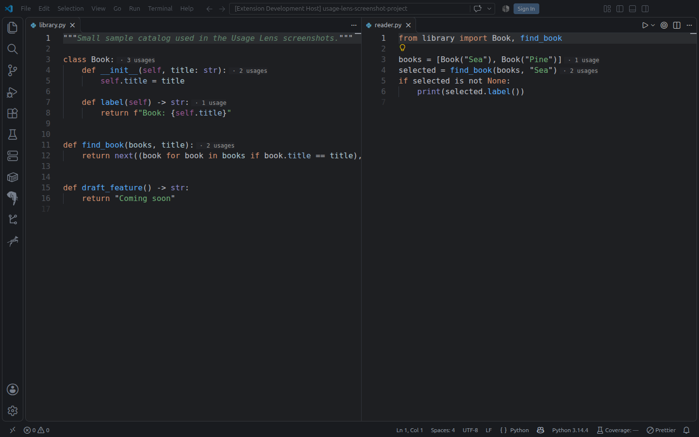
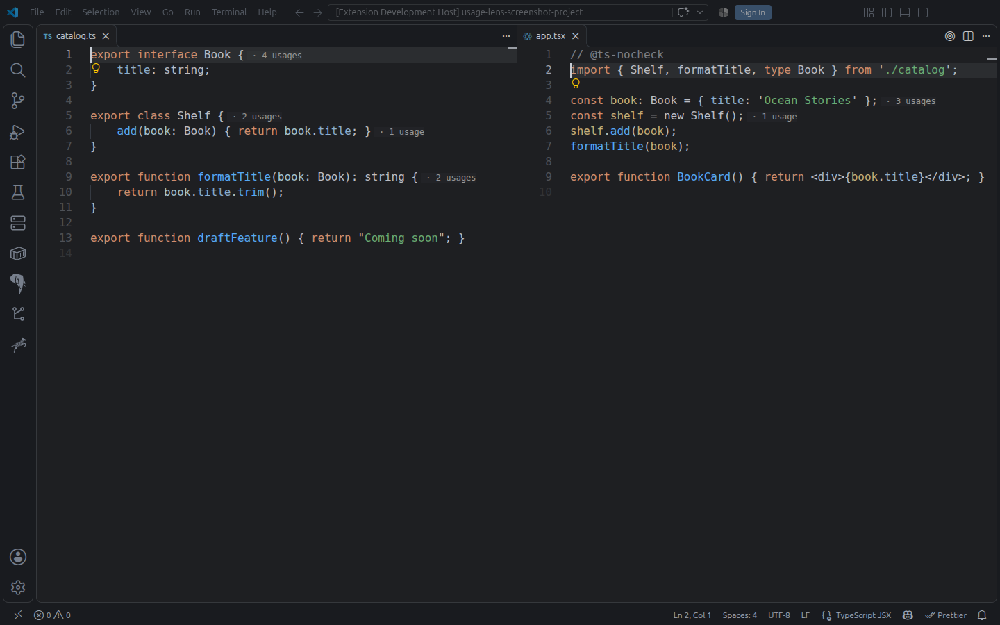
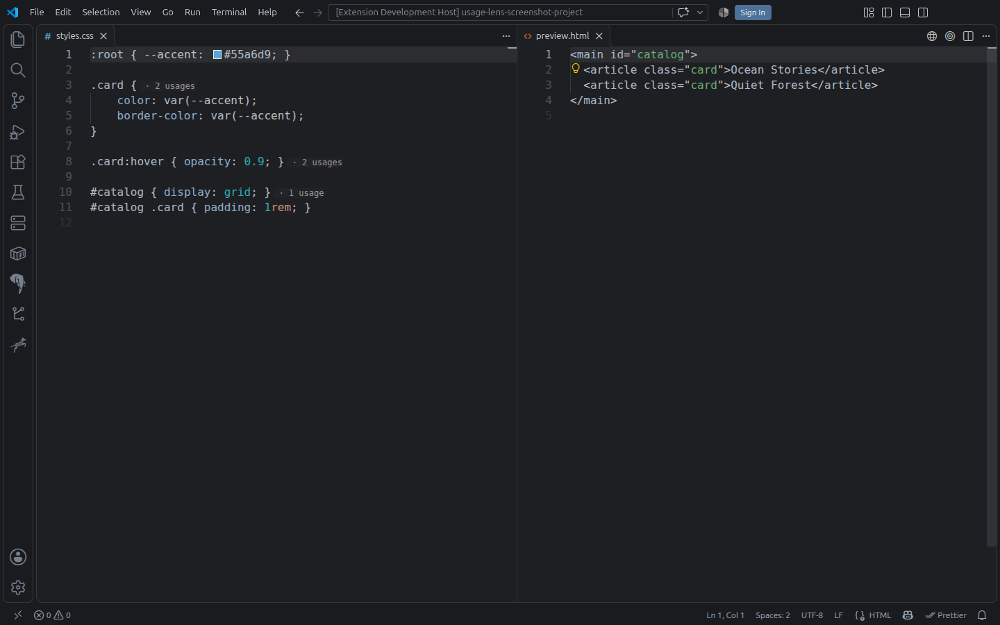

# Universal Usage Lens

Inline usage counts beside symbols, with CodeLens available as an alternate display mode.

## Features

- Hide zero-usage counts **and their reserved rows** by default.
- Include imports and exclude declarations by default.
- Python classes, methods and functions; TypeScript / JavaScript symbols, including React components, interfaces and enums.
- CSS-family symbols where a language server provides document symbols and references.
- Show usage counts inline at the end of declaration lines by default; optionally display them above declarations as CodeLens.
- Click counts to preview usages or choose direct navigation.
- Limit concurrent reference queries, deduplicate results and retry during initial language-server indexing.
- No telemetry, project execution or network uploads. Language servers determine references.

## Screenshots

Real VS Code captures from an isolated profile using a fictional library example. The code and comments were created specifically for these screenshots. Theme: [Quiet Ember Theme](https://marketplace.visualstudio.com/items?itemName=Toximiner.quiet-ember-theme).

### Python: imports count, unused symbols stay compact

The `Book` class has three usages: one import and two constructor calls. The declaration itself is excluded. `draft_feature` is unused, so it has neither a counter nor a reserved CodeLens row. Counts are provided through Pylance.



### TypeScript: interfaces, classes and methods

Usage counts come from VS Code's built-in TypeScript language provider. The side-by-side example shows declarations and their uses; `draftFeature` has no usages and creates no extra row.



### CSS: provider-backed selector usages

The built-in CSS language provider finds selector usages within this stylesheet. These counts do not imply automatic tracking of HTML or JSX class names.



## Language support

| Language | Provider |
| --- | --- |
| Python | Pylance, ty or another symbol/reference provider |
| TypeScript, TSX, JavaScript, JSX | VS Code built-in TypeScript language features |
| CSS, SCSS, Less | VS Code built-in CSS language features; references are typically limited to the current stylesheet |
| PostCSS (`.pcss`) | A provider supporting `postcss`, or CSS language mode via `files.associations`; parser support for custom mixins is provider-dependent |
| Other languages | Add language IDs to `usageLens.languages`; a symbol/reference provider is required |

CSS selector occurrences are not automatically equivalent to HTML / JSX `className` uses. This extension does not guess cross-language uses by text matching. Unsupported symbols produce no counts or extra rows.

Disable **Python Code Lens - Lite** in the workspace to avoid duplicate Python lenses.

## Settings

| Setting | Default |
| --- | --- |
| `usageLens.references.showZero` | `false` |
| `usageLens.displayMode` | `"inline"` |
| `usageLens.references.minCount` | `0` |
| `usageLens.references.filterImports` | `false` |
| `usageLens.references.filterDefinitions` | `true` |
| `usageLens.lenses.showImplementations` | `false` (Python-only) |
| `usageLens.clickAction` | `"peek"` |

**Universal Usage Lens: Refresh Lenses** clears cached counts. Indexing may take time on large projects.

If inline counts are not visible, check that VS Code's `editor.inlayHints.enabled` setting is not set to `off`.

Inline usage counts use VS Code's `editor.inlayHints.fontSize` setting. For a more subtle appearance, set it one step below the editor text size (for example, `12` when `editor.fontSize` is `16`). To match CodeLens exactly, set it to the same numeric value as `editor.codeLensFontSize`.

If your theme gives inline hints a visible background, you can make it transparent with VS Code's global theme customization:

```json
"workbench.colorCustomizations": {
  "editorInlayHint.background": "#00000000"
}
```

This affects all inline hints, not only Usage Lens.

## Build

```sh
npm ci --ignore-scripts
npm test
npm run package
```

Install the resulting VSIX with **Extensions: Install from VSIX…**.

## Validation

Unit regressions cover hidden rows, import inclusion, declaration exclusion, minimum counts, empty-result retry and cancellation. The VS Code integration suite in `scripts/test-vscode.cjs` uses fictional examples in `test-fixtures`: Python, TS, TSX, JS, JSX, CSS and PostCSS in CSS mode. It requires Pylance plus VS Code built-in TypeScript and CSS language features. No private project sources are included.

## Credits and license

Fork of [Python Code Lens - Lite](https://github.com/rafaelpeter03/python-codelens-lite) by [RafaelPeter](https://github.com/rafaelpeter03), under the MIT license. Original author and license notices are retained. This fork has a separate extension ID, commands and settings.
